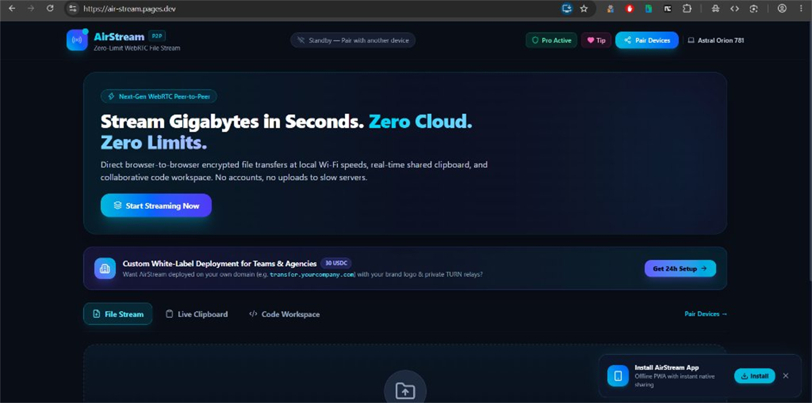
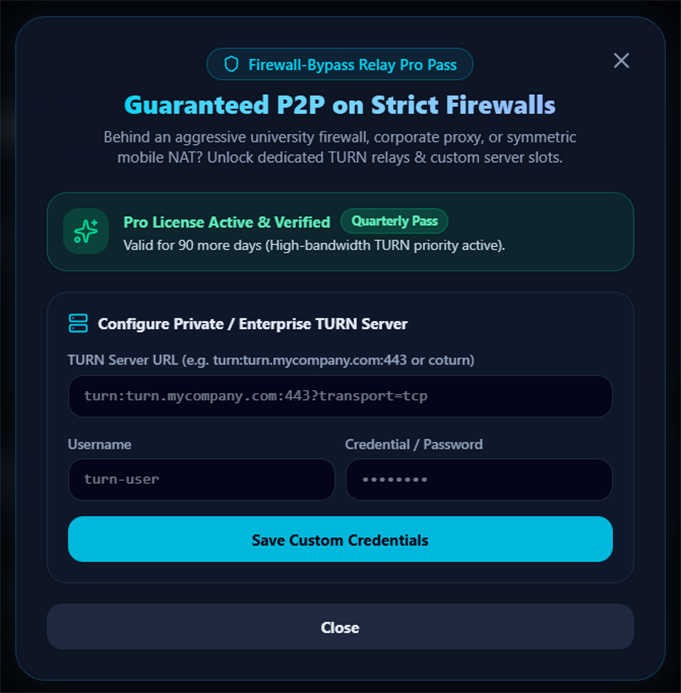
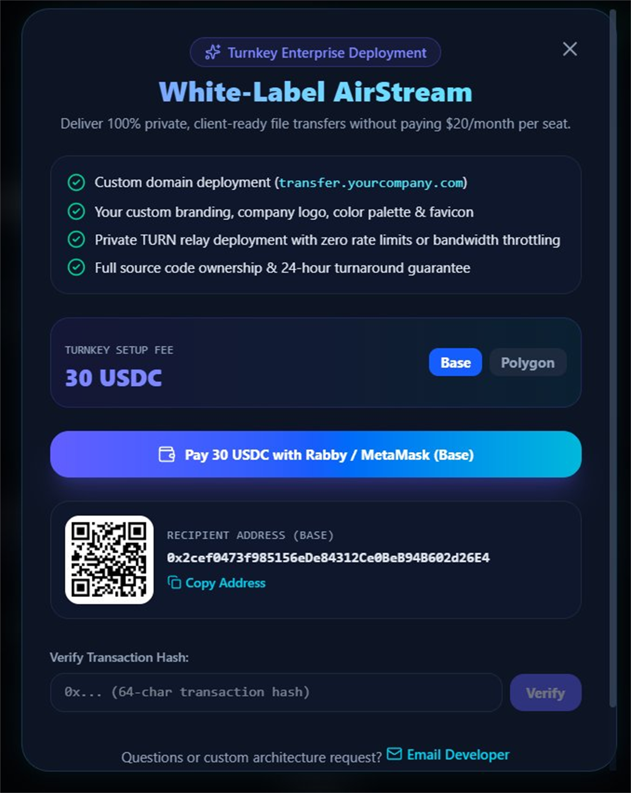
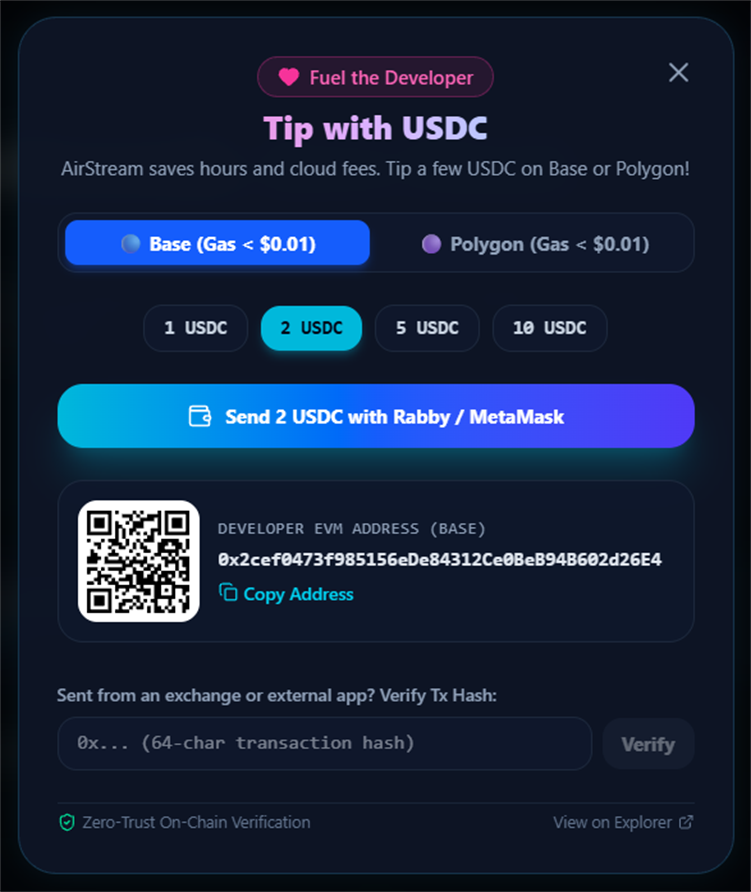

> **TL;DR**  
> 🚀 **Live Web App (Free, No Signup)**: [air-stream.pages.dev](https://air-stream.pages.dev)  
> ⭐ **GitHub Repo (MIT)**: [github.com/QuantumTechCoder/AirStream](https://github.com/QuantumTechCoder/AirStream)  
> 📖 **Missed Part 1?** Catch up here: [Show DEV: AirStream — Stream Gigabytes Browser-to-Browser with WebRTC (No Cloud, No Size Limits)](https://dev.to/quantumtechcoder/show-dev-airstream-stream-gigabytes-browser-to-browser-with-webrtc-no-cloud-no-size-limits-3kbh)

---

### The Indie Hacker's Worst Dilemma

In [Part 1 of this series](https://dev.to/quantumtechcoder/show-dev-airstream-stream-gigabytes-browser-to-browser-with-webrtc-no-cloud-no-size-limits-3kbh), I shared how I built **[AirStream](https://air-stream.pages.dev)**—an open-source PWA that opens encrypted, direct browser-to-browser data tunnels using WebRTC `RTCDataChannel`, letting people stream 10GB+ files at gigabit Wi-Fi speeds without cloud servers or size caps.

The feedback was incredible. But within 48 hours of launching, I hit the universal wall that every open-source builder eventually crashes into:

1. **Bandwidth isn't 100% free when firewalls get aggressive.** Standard STUN traversal handles ~85–90% of home networks. But users on strict corporate firewalls, university Wi-Fi, and symmetric mobile cellular NATs (like Reliance Jio or AT&T) require **TURN relay fallback servers**. High-bandwidth TURN relays cost real money to maintain.
2. **I despise aggressive SaaS paywalls.** Slapping a 2GB cap, forcing user registrations, or putting intrusive Google Ad banners on a clean privacy-first tool destroys everything that makes open-source great.
3. **Traditional payment processors (Stripe, PayPal) are terrible for lightweight indie apps.**

So I asked myself: *How can I keep AirStream 100% free and open-source forever, while creating ethical, frictionless revenue streams that actually respect user privacy?*

Here is the story of how I designed an **on-chain, zero-trust micropayment architecture** powered by USDC on Base and Polygon—and why web3 stablecoins turned out to be the ultimate indie monetization rail.

---

### Why Traditional Payment Rails Failed

When considering payments for an open-source tool, traditional options like Stripe or Lemonsqueezy seem like the default choice. But for AirStream, they created massive architectural friction:

* 💸 **The Flat-Fee Trap**: Stripe charges roughly **\$0.30 + 2.9%** per transaction. If someone transfers a 30GB video file and wants to send a \$1 or \$2 tip to say "thanks for saving my evening," **35% to 40% of their tip gets vaporized by processing fees**.
* 🌐 **Global Friction & KYC Walls**: A huge portion of our users are developers, video editors, and students in India, Latin America, Southeast Asia, and Eastern Europe. Stripe Checkout often rejects international cards or requires phone numbers, postal codes, and 3D-Secure redirects.
* 🗄️ **Database & Auth Bloat**: To verify paid subscriptions with Stripe Webhooks, I would have had to spin up a PostgreSQL database, write authentication logic (JWTs / OAuth), and store user emails. **AirStream has zero logins, zero databases, and zero user telemetry.** Introducing accounts just to process payments felt backwards.

---

### The Architecture: Zero-Trust On-Chain USDC (Base & Polygon)

Instead of traditional merchant processors, I implemented native **USDC payments on Layer-2 networks (Base and Polygon)**.

Why Base and Polygon?
1. **Negligible Gas Fees**: Transferring USDC on Base or Polygon costs **under \$0.01** (often \$0.003–\$0.005).
2. **Stable Currency**: USDC is pegged 1:1 to the US Dollar—no crypto price volatility for either the user or the developer.
3. **Decentralized Verification**: No backend database needed. The blockchain is an immutable public ledger. The client app can verify payments directly against decentralized RPC nodes!



---

### Maximum Security: Preventing Spoofed Payments

One of the biggest requirements was: **Make sure no one can fake payments or forge transactions.**

In a client-side web application, you cannot just trust a frontend input box that says *"I paid! Here's a transaction hash."* An attacker could try to:
- Paste a random transaction hash from an unrelated transfer.
- Paste a failed or reverted transaction.
- Paste a real transaction sent to someone else's wallet.
- Send 0.000001 USDC and claim a 30 USDC license.
- Reuse an old transaction hash from another user.

To make the verification **100% zero-trust**, I engineered an on-chain validator in TypeScript that inspects the raw EVM transaction receipts via decentralized JSON-RPC nodes:

```typescript
// src/utils/paymentVerifier.ts
export async function verifyOnChainPayment(
  txHash: string,
  expectedChain: SupportedChain,
  minUsdcAmount: number
): Promise<VerificationResult> {
  const cleanHash = txHash.trim();
  
  // 1. Verify 64-character hex format
  if (!/^0x([A-Fa-f0-9]{64})$/.test(cleanHash)) {
    return { valid: false, error: 'Invalid transaction hash format.' };
  }

  // 2. Fetch immutable transaction receipt directly from RPC
  const receipt = await rpcCall(expectedChain, 'eth_getTransactionReceipt', [cleanHash]);
  if (!receipt) {
    return { valid: false, error: 'Transaction still pending in mempool.' };
  }

  // 3. Ensure the transaction actually succeeded (status 0x1)
  if (receipt.status !== '0x1') {
    return { valid: false, error: 'Transaction was reverted on-chain.' };
  }

  const recipientNormalized = RECIPIENT_WALLET.toLowerCase();
  const network = NETWORKS[expectedChain];
  let isMatched = false;
  let matchedUsdcAmount = 0;

  // 4. Parse raw EVM event logs for ERC-20 Transfer
  if (Array.isArray(receipt.logs)) {
    for (const log of receipt.logs) {
      const contract = (log.address || '').toLowerCase();
      const isUsdc = contract === network.usdcAddress.toLowerCase();

      // Topic 0: Transfer(address,address,uint256) signature
      if (isUsdc && log.topics && log.topics[0] === TRANSFER_TOPIC) {
        // Topic 2: Recipient address (padded to 32 bytes)
        const toAddress = '0x' + log.topics[2].slice(26).toLowerCase();
        
        if (toAddress === recipientNormalized) {
          const rawValue = BigInt(log.data);
          const actualAmount = Number(rawValue) / Math.pow(10, network.usdcDecimals);

          // Verify exact expected amount (with 1% micro-rounding tolerance)
          if (actualAmount >= minUsdcAmount * 0.99) {
            matchedUsdcAmount = actualAmount;
            isMatched = true;
            break;
          }
        }
      }
    }
  }

  if (!isMatched) {
    return { valid: false, error: 'No matching USDC payment found in this receipt.' };
  }

  return { valid: true, txHash: cleanHash, amount: matchedUsdcAmount };
}
```

#### How this guarantees cryptographic security:
- **Receipt Status**: If a transaction reverted or threw an out-of-gas error, `receipt.status !== '0x1'` rejects it.
- **Contract Address Matching**: Only official USDC contract addresses (`0x833589...` on Base, `0x3c499c...` on Polygon) are parsed. Custom fake ERC-20 tokens are ignored.
- **Topic Decoding**: Decodes the padded 32-byte `to` address to ensure funds actually arrived at developer address `0x2cef0473f985156eDe84312Ce0BeB94B602d26E4`.
- **Decimal Precision**: Computes the exact integer value divided by $10^6$ (USDC decimals) to ensure the full amount was paid.

---

### The Sustainable Monetization Pillars

With zero-trust on-chain verification in place, I introduced two practical commercial offerings that keep the core P2P app 100% free while funding ongoing relay infrastructure:

#### 1. Firewall-Bypass TURN Relay Pro Pass (3 USDC / 3 Months)

For 90% of transfers, direct STUN works out of the box and is **100% free forever**.

However, students behind university firewalls or colleagues in strict corporate networks with symmetric NATs cannot establish direct UDP hole-punches.



- **Pricing**: 3 USDC for 3 months (just \$1/month).
- **Benefits**:
  - Direct access to high-bandwidth TCP/TLS TURN relays over port 443 (which corporate firewalls cannot block).
  - Custom enterprise TURN server inputs: Users can plug in their own private `coturn` or Twilio TURN credentials directly into the client.
- **Client-Side Storage**: The verified license and expiration timestamp are saved locally in `localStorage`, meaning zero accounts and zero tracked user data.

---

#### 2. Custom White-Label Deployment for Teams & Agencies (30 USDC)

Video production agencies, law firms, and medical clinics frequently deal with sensitive multi-gigabyte files. They don't want their clients to see an AirStream logo, nor do they want to pay \$20–\$30/user/month to WeTransfer or Dropbox Teams.



For a one-time setup fee of **30 USDC**:
- Deployment on their custom domain (e.g. `transfer.agency.com`).
- Custom branding, company logo, color palette, and favicon.
- Dedicated private TURN relay with unthrottled bandwidth.
- Full source code ownership & 24-hour turnaround.

---

### What I Learned: Web3 as the Indie Hacker's Payment Rail

Building this convinced me that low-cost EVM networks like Base and Polygon are vastly underrated for indie web apps:

1. **Zero Merchant Approval**: I didn't have to submit business registration forms, passports, or wait weeks for Stripe Atlas approval.
2. **Instant Global Reach**: Anyone in the world with an internet connection can pay \$1 or \$30 without currency conversion penalties.
3. **No Database Burden**: The blockchain serves as your payment database. You query receipts on-demand with open JSON-RPC endpoints.
4. **Keeps Open-Source Free**: By charging for convenience (white-labeling) and infrastructure-heavy edge cases (TURN relays), the core P2P application stays 100% free, MIT-licensed, and community-driven.

---

### Fuel the Dev (Tip Me a Coffee in USDC) ☕

Building and maintaining an open-source, privacy-first tool with zero tracking and zero cloud lock-in takes a lot of late nights and caffeine.

A tipping button shouldn't be masqueraded as a "product feature"—if AirStream genuinely saved your sanity, rescued you from a 2GB WeTransfer cap, or let you zap a 30GB video file across the room without paying a \$20/month SaaS subscription, feel free to fuel future development!



You can hit the **Tip** button directly on **[air-stream.pages.dev](https://air-stream.pages.dev)** to send 1, 2, 5, or 10 USDC with 1-click via Rabby / MetaMask (gas on Base and Polygon is less than a penny!), or send directly to my EVM address:
`0x2cef0473f985156eDe84312Ce0BeB94B602d26E4`

Every micro-tip keeps the project independent, free from corporate ads, and 100% open-source for everyone.

---

### What Do You Think?

- Have you experimented with accepting crypto micropayments or USDC for your open-source side projects?
- Would you rather pay \$1–\$3 once via web3 for utility tools or subscribe to another \$15/month SaaS?
- What other self-hosted or P2P features would make a tool like AirStream an absolute no-brainer for your team?

Drop your thoughts in the comments below! 👇

⭐ **Star the repo on GitHub**: [github.com/QuantumTechCoder/AirStream](https://github.com/QuantumTechCoder/AirStream)  
🚀 **Try AirStream live**: [air-stream.pages.dev](https://air-stream.pages.dev)
